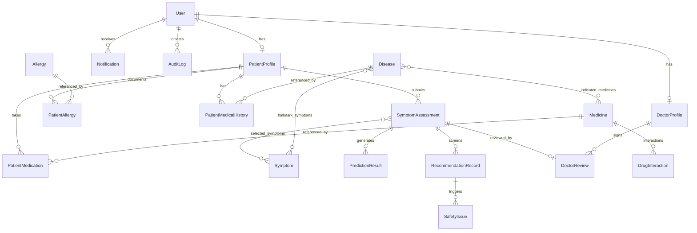

# AI-Based Drug Recommendation System
### Clinical Decision-Support & Medication Safety Screening Web Application

> **Academic Prototype Notice & Clinical Disclaimer:**  
> This software is an **academic clinical decision-support research prototype**. It is designed to assist qualified healthcare professionals by analyzing patient-reported symptoms, providing probabilistic machine learning differential condition estimations, and performing multi-layered medication safety screenings.  
> **This system must NEVER replace professional medical diagnosis, in-person clinical examination, or laboratory investigations, nor does it autonomously prescribe medicines.**

---

## 1. Overview & Architecture

The **AI-Based Drug Recommendation System** is an end-to-end, role-based medical web platform built with **Python 3.12**, **Django**, **NumPy**, **Joblib**, and **ReportLab**, styled with an **Apple Liquid Glass (Light Theme)** aesthetic.

### Architecture Highlights:
- **Role-Based Access Control (RBAC):** Distinct portals and permission boundaries for **Patients**, **Doctors (Physicians)**, and **Administrators**.
- **Clinical NLP Engine:** Normalizes free-text patient complaints, handles clinical negations (*e.g., "denies chest pain"*), and flags emergency red-flag symptoms.
- **Machine Learning Differential Diagnosis:** Vectorized multi-class probabilistic classification comparing **Decision Tree**, **Random Forest (Ensemble)**, and **Naive Bayes**, evaluated via held-out cross-validation without data leakage.
- **Traceable Medication & Safety Screening:** Curated reference datasets mapped to verified indications; rigorous 7-step screening detecting patient allergies, drug-drug interactions, medical history contraindications, age/pregnancy restrictions, and duplicate active ingredients.
- **Physician Review & Clinical Governance:** Auditable two-tier workflow where doctors review AI differentials, modify recommendations, formulate personalized instructions, and record electronic sign-offs.
- **Clinical PDF Export:** ReportLab-generated downloadable PDF clinical summaries with patient demographics, symptom duration, differential diagnoses, safety warnings, and physician notes.

---

## 2. Technology Stack

| Layer | Technologies |
| :--- | :--- |
| **Backend Framework** | Python 3.12, Django 6.1, Django ORM |
| **Frontend UI** | HTML5, CSS3, JavaScript (ES6+), Bootstrap 5.3, Bootstrap Icons |
| **Design Language** | Apple Liquid Glass (Light Theme: Frosted glass panels, translucent surfaces, blur backdrops, soft shadows) |
| **Machine Learning** | NumPy 2.5, Joblib 1.6, Scikit-learn compatibility |
| **NLP** | Custom clinical tokenizer, n-gram synonym matcher, negation extractor |
| **Reporting & Visualization**| ReportLab 5.1 (PDF Generation), Chart.js (Model Evaluation Metrics) |
| **Database** | SQLite3 for agile local development (100% compatible with PostgreSQL) |
| **Security & Auditing** | Django Authentication, CSRF Protection, Secure Session Cookies, Role-Based Access Decorators, Immutable Audit Logs |

---

## 3. Core System Modules

### Module 1: Authentication and Authorization
- **Custom User Model** (`accounts.User`) with three distinct roles: `PATIENT`, `DOCTOR`, and `ADMIN`.
- Secure registration workflows: Patient registration captures essential baseline medical demographics; Doctor registration captures license numbers and medical specializations.
- Role-based automated redirection (`role_redirect`) landing users directly in their designated portals.
- Strict record isolation preventing cross-patient data access.

### Module 2: Patient Profile and Medical History
- Stores patient demographics (Age, Gender, Blood Group, Pregnancy status, Emergency contacts).
- Interactive management of:
  - **Documented Allergies:** Active ingredients and clinical severity (*Mild, Moderate, Severe, Anaphylaxis*).
  - **Ongoing Medications:** Active prescription/OTC drugs to screen for drug-drug interactions.
  - **Medical History:** Chronic and managed conditions (*Asthma, Peptic Ulcer, Hypertension, etc.*) to screen for contraindications.

### Module 3: Interactive Symptom Checker
- Searchable symptom catalog containing 66 distinct symptoms grouped by anatomical and clinical categories.
- Real-time client-side filter and interactive glass chips.
- Natural Language text parser with automatic token extraction and negation filtering.
- Duration in days and severity scale (*Mild, Moderate, Severe*).
- **Red-Flag Emergency Detection:** Triggers prominent emergency escalation alerts (*e.g., severe chest pain, dyspnea*).
- **Pre-Analysis Confirmation Screen:** Mandatory review screen allowing patients to verify reported symptoms before invoking the ML engine.

### Module 4: Machine Learning Disease Prediction Pipeline
- Probabilistic symptom-disease matrix trained across 15 target conditions with 66 clinical features.
- Evaluates and compares three classifiers on held-out test splits:
  - **Decision Tree Classifier (CART)**
  - **Random Forest Classifier (Ensemble with Feature Subsampling)**
  - **Multinomial Naive Bayes (Laplace-smoothed Log-Likelihood)**
- Computes comprehensive evaluation metrics: **Accuracy**, **Weighted Precision**, **Recall**, **F1-Score**, and **Confusion Matrix**.
- Serializes the best-performing model pipeline using Joblib (`ml_models/active_model.joblib`).
- Inference service (`ml_engine.predictor`) provides calibrated differential probabilities for primary and secondary conditions.

### Module 5: Medicine Information Engine
- Curated reference catalog of essential medicines with standardized generic names, active ingredients, approved indications, dosage forms, and source citations (*WHO Model List of Essential Medicines / BNF / FDA monographs*).
- Clear demarcation between prescription-only (*Rx*) and over-the-counter (*OTC*) medicines.
- Distinguishes general educational reference from doctor-endorsed recommendations.

### Module 6: Drug Safety and Interaction Checks
Multi-layered algorithmic screening executed prior to presenting any candidate medicine:
1. **Patient Allergy Check:** Cross-references active pharmaceutical ingredients against patient allergy records.
2. **Drug-Drug Interaction Check:** Compares candidate medicines against the patient's active medication list.
3. **Clinical Contraindications Check:** Screens patient medical history against documented drug contraindications (*e.g., NSAIDs in peptic ulcer disease*).
4. **Age Restrictions:** Enforces pediatric and geriatric minimum/maximum approved age thresholds (*e.g., Aspirin in patients < 16*).
5. **Pregnancy Safety:** Detects FDA Pregnancy Categories (C, D, X) and evaluates maternal/fetal risk in pregnant patients.
6. **Duplicate Active Ingredients:** Prevents accidental cumulative toxicity from identical active ingredients.
7. **Recommendation Suppression:** If a high-risk safety hazard is detected, the candidate recommendation is **SUPPRESSED** (`is_suppressed=True`), flagged with a prominent red alert card, and prohibited from self-medication guidance until reviewed by a physician.

### Module 7: Patient Dashboard
- Clean health overview featuring 4 statistics widgets (Total Assessments, Active Medications, Logged Allergies, Chronic Conditions).
- Recent assessment summary table with quick review links.
- Interactive medical profile summary cards with allergy and medication pills.
- Quick-launch button for new symptom checks.

### Module 8: Doctor Dashboard & Triage Queue
- Physician workspace displaying pending and reviewed patient assessments.
- Triage filters (*All, Pending Review, Reviewed*).
- In-depth clinical review interface:
  - Comprehensive inspection of patient history, allergies, and reported symptoms.
  - Review of ML differential conditions and calibrated confidence scores.
  - Review of candidate medicines and safety screening warnings.
  - Form to record independent clinical diagnostic impressions, endorse/modify medicines, formulate direct patient instructions, and provide follow-up advice.
  - Electronically authenticated signature timestamp and license recording.

### Module 9: Medical History & Clinical PDF Reports
- Full historical tracking of completed assessments.
- **Downloadable Clinical PDF Reports:** Generated using ReportLab with clean typography, tables, emergency banners, differential probabilities, screened medicine statuses, and physician sign-off blocks.

### Module 10: Admin Panel & ML Analytics
- Access to standard Django Admin (`/admin/`) for reference data curation.
- **Custom Admin Analytics Dashboard:** Interactive Chart.js comparative performance chart (Accuracy, Precision, Recall, F1 for all three algorithms), confusion matrix visualizer, dataset provenance tracker, and immutable security audit logs.

### Module 11: Notifications & Safety Guidance
- In-app notification center with unread counters and mark-as-read AJAX triggers.
- Alerts on assessment completion, physician review sign-offs, and critical emergency red flags.

### Module 12: Audit & Security Logging
- Automatic tracking of security events: `LOGIN`, `LOGOUT`, `REGISTRATION`, `ASSESSMENT_CREATED`, `PREDICTION_RUN`, `RECOMMENDATION_SCREENED`, `DOCTOR_REVIEW`, `ACCESS_DENIED`.
- Stores client IP address, user-agent, user ID, and action description.

---

## 4. Apple Liquid Glass UI Design

The user interface follows Apple's Liquid Glass light theme design language:

```css
Primary Background:     #F5F8FC
Secondary Background:   #EEF3F8
Glass Panel Surface:    rgba(255, 255, 255, 0.72) with backdrop-filter: blur(16px)
Glass Border:           1px solid rgba(255, 255, 255, 0.85) / rgba(215, 227, 240, 0.75)
Primary Accent:         #3984E8 (Vibrant Clinical Blue)
Secondary Accent:       #54B7C5 (Cyan / Teal)
Primary Text:           #172B45 (Deep Slate)
Secondary Text:         #6B7C93 (Subtle Grey)
Success / Safe:         #22A06B
Warning / Precaution:   #E9A23B
Danger / Emergency:     #E05252
```

### Visual Components:
- **Translucent frosted glass cards and sidebars** that allow background ambient gradients to softly diffuse through.
- **Interactive symptom pills** with micro-transitions and glowing borders upon selection.
- **Pill-shaped action buttons** with gradient fills and layered soft drop-shadows (`0 4px 14px rgba(57, 132, 232, 0.28)`).
- **Responsive desktop sidebar** and mobile-optimized offcanvas navigation.

---

## 5. Database Schema & Entities



---

## 6. Installation & Quick Start

### Prerequisites
- Python 3.10+ (Tested on Python 3.12.3)
- pip or uv package manager
- SQLite3 (Default) or PostgreSQL

### 1. Clone & Set Up Virtual Environment
```bash
cd "Drug Recomendation"
python3 -m venv venv
source venv/bin/activate
```

### 2. Install Project Dependencies
```bash
pip install -r requirements.txt
```

### 3. Configure Environment Variables
Copy `.env.example` to `.env`:
```bash
cp .env.example .env
```

### 4. Run Database Migrations
```bash
python manage.py migrate
```

### 5. Seed Curated Medical Data & Demo Accounts
```bash
python manage.py seed_medical_data
```
*This command seeds 66 clinical symptoms, 15 clinical diseases, 13 traceable medicines, verified drug-drug interactions, reference allergies, and initializes 3 pre-configured demonstration accounts.*

### 6. Train the Machine Learning Pipeline
```bash
python manage.py train_models
```
*This command generates the benchmark clinical matrix, trains Decision Tree, Random Forest, and Naive Bayes classifiers, records accuracy/precision/recall/F1 metrics, and saves the active model to `ml_models/active_model.joblib`.*

### 7. Run the Local Development Server
```bash
python manage.py runserver
```
Access the application at: `http://127.0.0.1:8000/`

---

## 7. Pre-Configured Demonstration Accounts

| Role | Username | Password | Purpose / Access |
| :--- | :--- | :--- | :--- |
| **Patient** | `patient_john` | `Patient@12345` | Test Symptom Checker, Medical Profile, Past Assessments, PDF Downloads |
| **Doctor** | `doctor_smith` | `Doctor@12345` | Triage Queue, Clinical Review Workspace, Approving / Modifying Recommendations |
| **Administrator**| `admin` | `Admin@12345` | Model Evaluation Analytics Dashboard, Django Admin (`/admin/`), Audit Logs |

*(Quick-fill buttons are provided directly on the login page for testing convenience).*

---

## 8. Running Automated Tests

The application includes an extensive test suite covering models, authentication, patient record isolation, NLP parsing, negation handling, emergency triggers, ML algorithms, drug safety screening, doctor review workflows, and PDF generation.

Execute all 32 automated tests:
```bash
python manage.py test
```

Expected output:
```text
Found 32 test(s).
Creating test database for alias 'default'...
System check identified no issues (0 silenced).
................................
----------------------------------------------------------------------
Ran 32 tests in 32.533s

OK
Destroying test database for alias 'default'...
```

---

## 9. Regulatory & Academic Disclaimer

This application is created as an **academic clinical decision-support prototype**.  
- It does **not** possess FDA, CE mark, or other medical device regulatory certifications.
- Predictions generated by machine learning models are mathematical probabilities based on benchmark datasets and do **not** represent confirmed medical diagnoses.
- Medicine records provided are for educational reference and clinical review. Qualified physicians must independently assess patient history, physical examination, and laboratory tests before prescribing any medication.
